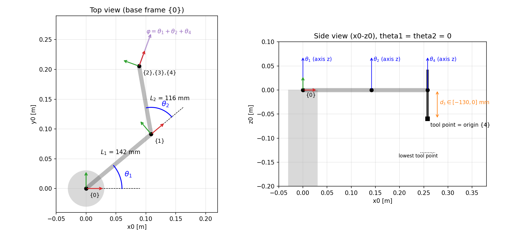

# Mô phỏng và điều khiển robot SCARA Yamaha YK-XG

Bài tập lớn: robot SCARA 4 bậc tự do, gồm:
- **Khớp:** J1 vai, J2 khuỷu, J3 trục Z tịnh tiến, J4 xoay công cụ.
- **Nền tảng:** mô phỏng bằng **Python + MuJoCo**.
- **Nội dung:**
  - Động học (DH, FK, IK, Jacobian).
  - Thiết kế quỹ đạo (đường thẳng, đường tròn, vẽ hình/chữ).
  - Động lực học M(q), C(q, q̇), G(q).
  - Bộ PID 4 trục.
  - Giao diện điều khiển.
  - Cầu nối ROS 2.



## Cài đặt

```bash
sudo apt install python3-tk
pip install -r requirements.txt        # mujoco, numpy, matplotlib
```

## Chạy

```bash
python3 scara_control_panel.py         # giao diện điều khiển + viewer 3D MuJoCo
python3 run_experiments.py             # sinh lại toàn bộ kết quả vào results/ (~40 s)
python3 mujoco_sim/run_mujoco.py       # demo viewer, các khớp chạy theo hàm sin
```

### Giao diện (`scara_control_panel.py`)

**Thanh công cụ**
- Chọn chế độ:
  - **Kinematic**: robot đi đúng quỹ đạo đặt.
  - **PID control**: robot chạy theo mômen của bộ PID trên mô hình động lực học.
- Các nút **Home**, **STOP** (phím Esc), thanh **Speed override** và nút đổi nền sáng/tối.

**Các tab**

| Tab | Chức năng |
|---|---|
| **Joint** | Đặt từng biến khớp bằng thanh trượt hoặc ô nhập. |
| **Jog** | Di chuyển theo X, Y, Z, φ; đi tới tư thế (x, y, z, φ) cho trước; chọn nhánh khuỷu. |
| **Path** | Chọn quỹ đạo Waypoints / Line / Circle / Shape (hình hoặc chữ, có nâng–hạ bút). Quỹ đạo được kiểm tra trước khi chạy. |
| **Trajectory** | Đồ thị khớp (q, q̇, q̈), sai số bám, mômen, quỹ đạo đầu công tác (x, y, z, φ và XY), so sánh đặt và đáp ứng. |
| **PID** | Chỉnh Kp, Ki, Kd, τ_max từng trục, feed-forward và chống bão hòa tích phân. |

## Kết quả

Bảng số liệu nằm trong [results/summary.md](results/summary.md), đồ thị nằm trong `results/<mục>/`.

| Mục | Nội dung | Kết quả chính |
|---|---|---|
| 2.1 | Hình học, bảng DH, không gian làm việc | Vành khuyên 84–258 mm, Z 0 … −130 mm |
| 7.2 | Chuyển động từng khớp, kiểm chứng động học | FK→IK→FK sai số ~1e-16 m; Jacobian giải tích khớp Jacobian số (4e-10) |
| 7.3 | Chuyển động qua các tư thế cho trước | Sai số đầu công tác ≤ 0,51 mm |
| 7.4 | Đường thẳng | Lệch khỏi đường thẳng ≤ 0,12 mm |
| 7.5 | Đường tròn r = 50 mm | Sai số ≤ 0,16 mm (4 s), ≤ 0,97 mm (2 s) |
| 7.6 | Vẽ chữ "HUST" và ngôi sao | Sai số khi bút hạ ≤ 0,45 mm |
| 7.7 | Đánh giá PID | Feed-forward đầy đủ giảm sai số đường tròn 2 s từ 0,97 xuống 0,11 mm; chống bão hòa: xác lập 0,65 s, không có thì còn sai số 33° sau 3 s |

Các giá trị giả định:
- Giới hạn mômen: [40, 20, 50, 2].
- Ma sát nhớt B: [0,5; 0,3; 5; 0,02].
- Giới hạn vận tốc và gia tốc của quỹ đạo.

Thông số khối lượng và quán tính được tính từ mô hình CAD.

## Cấu trúc

| File | Nội dung |
|---|---|
| `scara_kinematics.py` | Bảng DH, động học thuận/nghịch, Jacobian, điểm kỳ dị |
| `scara_trajectory.py` | Luật chuyển động (Linear, Trapezoidal, S-curve), quỹ đạo khớp, đường thẳng, đường tròn, nét vẽ |
| `shapes.py` | Hình vuông, tam giác, ngôi sao, font nét đơn A–Z, 0–9 |
| `scara_dynamics.py` | M(q), C(q, q̇), G(q) theo phương pháp Jacobian |
| `scara_control.py` | Bộ PID 4 trục, mô hình robot điều khiển bằng mômen |
| `scara_control_panel.py` | Giao diện điều khiển và vòng mô phỏng thời gian thực |
| `run_experiments.py` | Sinh đồ thị và bảng kết quả |
| `mujoco_sim/` | Mô hình MuJoCo (`scara_real.xml`) và mesh STL |
| `ros2_ws/src/scara_sim/` | Node ROS 2 `mujoco_bridge`: nhận `/joint_cmds`, phát `/joint_states` 100 Hz |

## ROS 2 (Humble)

```bash
cd ros2_ws && colcon build && source install/setup.bash
ros2 launch scara_sim mujoco_bridge.launch.py
ros2 topic pub --once /joint_cmds sensor_msgs/msg/JointState "{name: [joint1], position: [0.8]}"
```

## Ghi chú

- **Robot mô phỏng:** dùng hình học **YK-XG** (L1 = 142 mm, L2 = 116 mm), không phải YK400XE-4 như tên đề tài.
- **Tọa độ:** hệ {0} của động học là hệ thế giới MuJoCo xoay 180° quanh trục z.
- **Đơn vị:** bên trong dùng SI (rad, m); giao diện hiển thị độ và mm.
